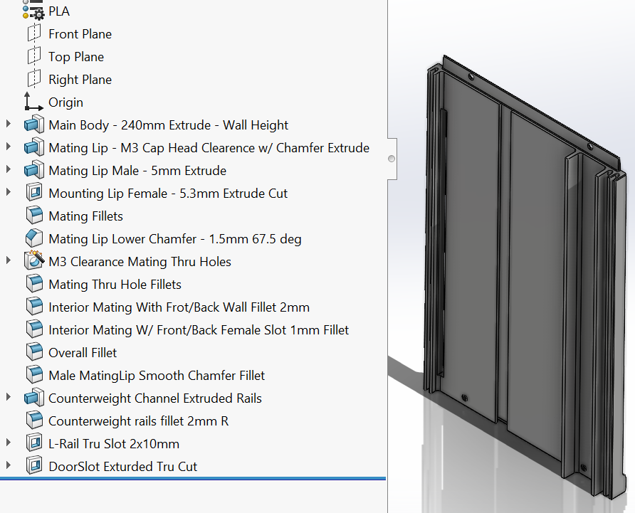

Current project progress is outline below. More recent changes and active progress is found at the top.

<b>Overall (Parametric Redesign) ::2026-11-02</b>

### Update, busy with other projects up to this point. Just revisted the redesign
  * Finished up the left and right panel
  * Working on the mid back panel
  * placed the left/right/back panels into a new assembly
  * Decided to redesign the cable to mount to the card from underneeth and hang
  * Decided to use only one main power trunk to the car and have a circuitboard underneith
  * Decided to use switch from 3d printer, cheap chinese switch for basement limit and the z homing
  * Decided to order new limit switches with a more appropariate arm, if this doesnt work I will design my own limit switch or redesign the car lever better

  I will try to come back to this project more frequently to get it done.
/

<b>Left Side Wall (Parametric Redesign) ::2026-08-25</b>

  
### Current Focus: Parametric sesign and locking in measurements as equations
- [x] Main Body
- [x] Side Mating Channel
- [x] Counterweight Guides
- [x] L-Bar Slot
- [x] Vertical Panel Mating Features
- [x] Pla material created and applied
- [ ] DoorSlot (Still needs Testing)
- [x] Material removal to reduce weight with releifs
- [x] Weight reducion pockets (with corner radi)

The current progress include additional releif pockets and reduced materials not shown in the above image. Weight was 220g+ now sits at 135g.

<b>Inspect current progress and Identify Issues ::2026-08-19</b>

### Current Focus: Finding issues in the system that need itterations
- [x] Discovered many areas of key improvement
- [x] Outlined a logical order of next designs and itterations
- [x] Created this repository

